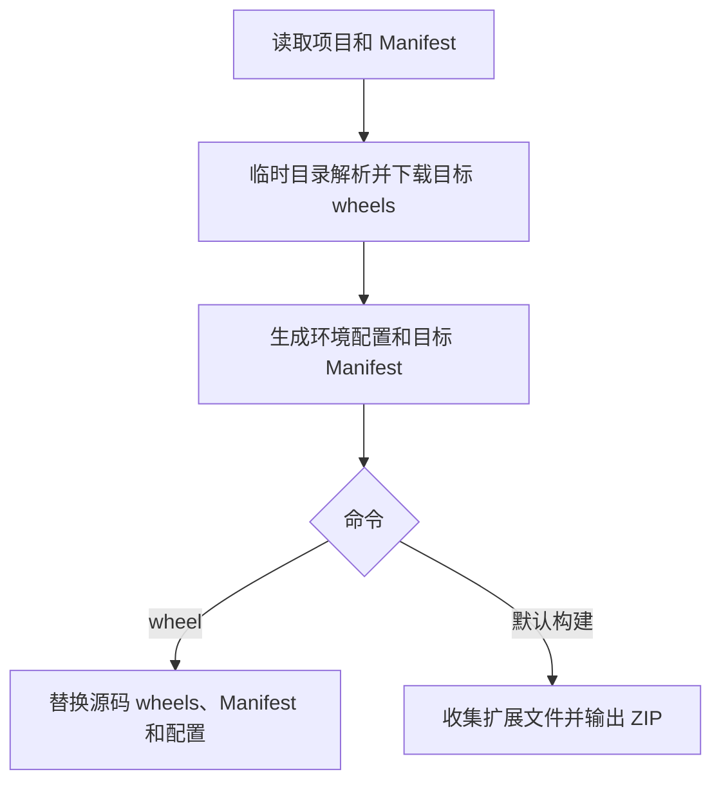

## Context

JobRuntime 构造函数同时接受 Server 入口、路径基准、存储目录、环境、回调和命名空间。实例已有 Server、环境安装、Operator、进度和注册职责。AnyImage 的打包脚本还承担 wheels 下载、多 Python 目标处理、Manifest 更新和 ZIP 输出。项目根目录的 pyproject.toml 当前不会进入扩展 ZIP。

## Goals / Non-Goals

**Goals:** 用 BlendJob 表达扩展级入口；以项目文件声明环境；提供独立 wheel 命令和默认构建命令；保证开发配置与发布配置一致。

**Non-Goals:** 本地任务执行框架、LocalOperatorBase、模型上传、节点资产生成、AnyImage 接入代码迁移和本次实际发布。

## Decisions

### 1. 单一实例入口与可选参数

公开接口采用 `BlendJob(namespace, *, server=None, environment=None, storage_root=None, post_install=None)`。options 表示可选关键字参数，不增加配置对象。实例继续提供 `JobOperatorBase`、register/unregister、request 和已有环境及 Server 控制入口。post_install 保留普通 callable，安装完成后接收该 BlendJob 实例，可通过 request 提交下载任务。

namespace 使用适合 Blender Operator 前缀的非空小写标识符，拒绝路径分隔符、点和路径穿越。默认存储位置为 `Path.home() / f".{namespace}"`。自定义 storage_root 保留字符串、Path 和无参 callable，延续 Preferences 的动态读取能力。创建实例只解析和校验配置，不创建存储目录、安装环境、启动 Server 或注册 Blender 类型。

将 JobRuntime 的实现和引用迁入职责明确的 integration 模块，删除旧公开名称与别名；继续使用 JobOperatorBase，无需 ServerOperatorBase 改名。已有进度跨窗口刷新和取消行为必须保留。

### 2. 调用方定位与 Server 入口

构造时仅捕获直接调用者的文件路径，释放 frame 引用。默认 Server 为调用方目录下 `server/__init__.py` 的 `server` 对象，不使用进程 cwd。包装工厂函数以工厂文件为调用方，不搜索任意上层 frame。

server 可传入目录、Python 文件或现有 `path:attribute` 字符串；没有属性名时默认 server；相对路径以调用方目录为基准，绝对路径直接使用。无法取得调用方路径时，仅当显式绝对 Server 入口和显式环境足以消除定位需求才允许创建，否则给出可操作错误。

替代方案是强制传入 entrypoint_root；自动定位覆盖常规扩展目录，显式 server 处理特殊布局，减少一个公开概念。

### 3. 环境声明与读取优先级

```toml
[dependency-groups]
blendjob = [
    "pillow==12.1.1",
    "onnxruntime-directml==1.24.4; sys_platform == 'win32'",
    "onnxruntime==1.24.4; sys_platform != 'win32'",
]

[tool.blendjob]
python = "3.12"
```

显式 environment 完整覆盖文件来源，沿用已有 python/packages/platform_packages 字典校验，不逐字段合并。否则从调用方目录向上查找最近的 pyproject.toml。没有跨越扩展 Manifest 根目录时，直接采用最近文件；跨越该根目录时，只有候选项目的 tool.blendjob.build.source 解析后等于该扩展根目录，才视为当前开发项目。其他宿主项目不作为配置来源。没有所属项目时读取扩展根目录的 blendjob.json。

已确认的项目配置优先于生成 JSON，保证 wheel 后修改 pyproject.toml 立即生效。最近项目文件损坏、blendjob 组或 tool.blendjob.python 缺失均报错，不向更远项目或旧 JSON 回退。没有 Manifest 时，发布配置仅检查调用方目录。配置发现只决定环境来源，不移动默认 Server 位置。

环境解析集中于 configuration 模块；Python 3.10 使用条件依赖 tomli，3.11+ 使用 tomllib。
依赖组名称按标准归一化，递归展开 include-group，检测名称冲突、循环和缺失引用。保留依赖要求和环境标记，交给目标 Server Python 安装时评估，不在构建主机上筛选。Server Python 独立配置，不从 Blender 项目的 requires-python 推导。FastAPI 和 Uvicorn 继续由 BlendJob 维护。

这里显式规定源码匹配，是为了让有 Manifest 的 src 布局支持自动读取，同时避免无限向上搜索错误项目。环境解析集中于 configuration 模块；Python 3.10 使用条件依赖 tomli，3.11+ 使用 tomllib。

### 4. 生成发布配置

提供 `blendjob.build.export_environment(project_file, destination)`，读取同一解析器并写出 UTF-8 blendjob.json：包含 schema、python、展开后的 packages。生成内容只包含 Server 环境；显式 runtime environment 仍可覆盖。JSON 不包含机器绝对路径、存储目录、回调、开发依赖或构建目录。已有 environment_hash 从归一化结果计算，开发和发布结果一致。

发布包在扩展根目录携带 blendjob.json。未知 schema 或损坏内容报错。工具通过临时文件替换输出，拒绝无法分发的本地路径依赖；不生成第二份 pyproject.toml，避免在包内伪造开发项目结构。

### 5. CLI 与构建配置

```text
uv run blendjob                       构建配置中的全部平台
uv run blendjob -p windows-x64        构建指定平台
uv run blendjob wheel                准备当前主机平台的源码依赖
uv run blendjob wheel -p windows-x64  准备指定平台的源码依赖
```

-p 与 --platform 等价，均支持放在 wheel 前后；重复指定平台报错。默认命令负责构建，不增加必需的 build 子命令。--help 列出默认动作、wheel 动作和平台列表。build extra 提供构建专用依赖，缺失时提示安装 `blendjob[build]`。CLI 导入和执行不依赖 bpy。

```toml
[tool.blendjob.build]
source = "src/anyimage"
output = "dist"
platforms = ["windows-x64", "macos-arm64", "linux-x64"]

[[tool.blendjob.build.targets]]
python = "3.11"
provided-packages = ["numpy>=1.26,<2.0"]

[[tool.blendjob.build.targets]]
python = "3.13"
provided-packages = ["numpy>=2.1,<3.0"]
```

source 和 targets 必填；output 默认 dist；platforms 默认上述三平台。路径相对 CLI 定位的最近项目文件，source 必须属于项目目录，output 不得位于 source 内。Python 目标和 Blender 内置包约束由项目声明，不内置 AnyImage 的 NumPy 版本规则。Manifest 提供扩展 name、id、version 等元数据；不从 PyPI 项目名称推导扩展身份。

project.dependencies 仅用于准备 Blender 端 wheels。使用构建环境中的 pip download，传入目标平台、Python、CPython ABI 和 only-binary，解析目标依赖；正确处理目标环境标记，并通过专门测试校验跨平台结果，不能依赖宿主环境误筛依赖。provided-packages 参与对应目标的解析约束，但从随包 wheels 中排除。多 Python 目标合并 wheels，纯 Python 包保持共同兼容版本；约束冲突明确失败。源码 wheels 作为本地候选源，保留本地 BlendJob wheel 的接入方式。Server 组只导出配置，不下载至扩展 wheels。

### 6. wheel 与发布构建共用准备流程



wheel 在全部下载和校验成功后提交 wheels、Manifest、blendjob.json；清理不再选择的旧 wheel。提交失败恢复原状态，不能留下新 Manifest 引用缺失文件。

默认构建全过程在临时目录执行，不改源码 wheels、Manifest 和配置。ZIP 根包含 Manifest、blendjob.json 和 wheels；按 Manifest 的真实名称、版本与目标平台命名为 `<name>.v<version>.<platform>.zip`。文件收集遵循 Manifest build.paths_exclude，并排除 __pycache__、pyc、Blender 备份和源码旧 wheels/生成配置；Manifest 其他字段和已有表必须保留。source 外的符号链接拒绝跟随。每个平台 ZIP 验证后原子替换最终文件；多平台失败时报告已成功平台和失败平台，保留已有有效包。

## Risks / Trade-offs

- 调用栈定位受工厂函数影响 → 仅取直接调用者，显式 server/environment 可覆盖。
- 开发目录与安装目录布局不同 → 通过项目 source 匹配限定开发回溯，覆盖有 Manifest 的 src 布局与已安装扩展测试。
- 多 Python 和平台依赖复杂 → 构建目标显式声明，以解析失败代替生成缺依赖包；测试目标标记及内置包过滤。
- 源码准备涉及多个文件 → 临时准备、提交备份和失败回滚；构建默认不修改源码。
- 功能增加带来依赖 → 构建依赖隔离在 build extra，保持 Blender 端基础导入轻量。

## Migration Plan

在 BlendJob 内替换公开入口及测试调用，添加配置与 CLI 能力后运行相关和完整测试。发布时旧调用方需要将 JobRuntime 改为 BlendJob，并采用可选参数或项目声明；不保留兼容别名。AnyImage 迁移另行实施。回退使用先前版本及原有显式环境配置。本次仅生成提案，不构建 wheel、扩展包或文档。

## Open Questions

无阻塞项；以上 CLI、默认值和配置结构作为本次实现基线。
